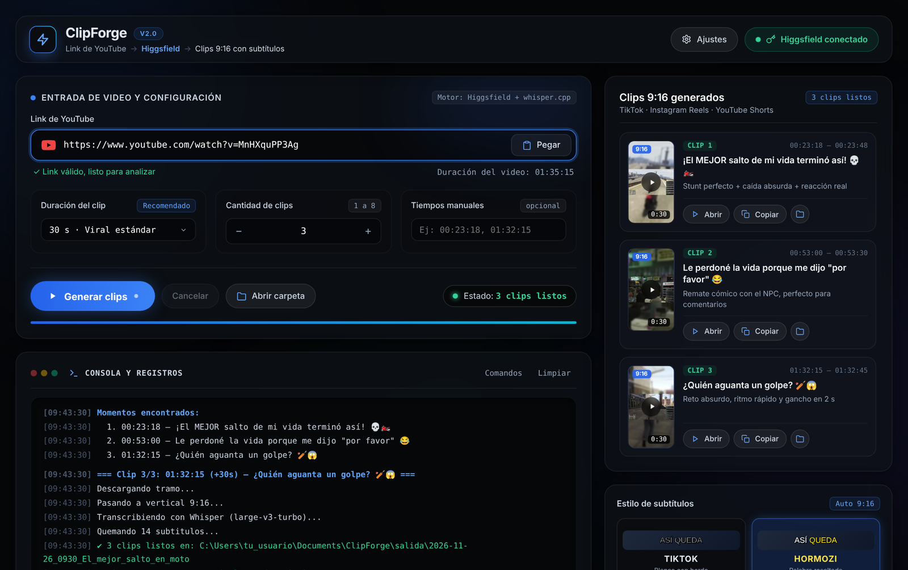

<p align="center">
  
</p>

<h1 align="center">ClipForge</h1>

<p align="center">
  Convierte videos y directos de YouTube en <b>clips verticales 9:16 con subtítulos</b>, listos para TikTok, Instagram Reels y YouTube Shorts.<br>
  Pegas el link, eliges cuántos clips quieres y ClipForge hace el resto.
</p>

<p align="center">
  <a href="https://github.com/RenatoAlexanderTI/clip-forge/releases"></a>
  
  
  <a href="LICENSE"></a>
</p>

<p align="center">
  
</p>

---

## Índice

1. [Qué hace](#qué-hace)
2. [Requisitos](#requisitos)
3. [Instalación paso a paso](#instalación-paso-a-paso)
4. [Primer uso](#primer-uso)
5. [Cómo se usa](#cómo-se-usa)
6. [Ajustes](#ajustes)
7. [Qué archivos genera](#qué-archivos-genera)
8. [Solución de problemas](#solución-de-problemas)
9. [Actualizar y desinstalar](#actualizar-y-desinstalar)
10. [Privacidad](#privacidad)
11. [Contribuir](#contribuir)
12. [Licencia](#licencia)

---

## Qué hace

1. **Pegas un link de YouTube** y eliges la duración (15–90 s) y la cantidad de clips (1–8).
2. **Higgsfield** analiza el video con IA y encuentra los momentos con más potencial viral, cada uno con un título y una descripción sugeridos.
3. **yt-dlp** descarga solo esos tramos, no el video completo.
4. **ffmpeg** los pasa a vertical 9:16:
   - con **facecam**: la cámara arriba y el juego abajo;
   - **sin facecam**: el video centrado sobre un fondo desenfocado.
5. **whisper.cpp** (modelo `large-v3-turbo`) transcribe el audio en español y quema los subtítulos con el estilo elegido:

| Estilo | Cómo se ve |
|---|---|
| **TikTok** | Mayúsculas blancas con borde negro |
| **Hormozi** | Mayúsculas blancas con la palabra clave en amarillo |
| **Minimal** | Texto limpio y fino, sin mayúsculas |
| **Beast** | Grande, con colores que van cambiando y animación |

Además deja un `.srt` por clip (para editarlo en CapCut) y un `resumen.txt` con los tiempos, títulos y descripciones.

> Si ya conoces los momentos, escríbelos en **Tiempos manuales** y ClipForge se salta Higgsfield (no gasta créditos ni necesita cuenta).

---

## Requisitos

| Qué | Para qué | ¿Obligatorio? |
|---|---|---|
| Windows 10 u 11 (64 bits) | Sistema operativo | Sí |
| [Python](https://www.python.org/downloads/) 3.10 o superior | Ejecutar ClipForge | Sí |
| [yt-dlp](https://github.com/yt-dlp/yt-dlp) | Descargar los tramos de YouTube | Sí |
| [FFmpeg](https://ffmpeg.org) | Recortar, pasar a vertical y quemar subtítulos | Sí |
| [Deno](https://deno.com) | yt-dlp lo necesita para leer YouTube | Sí |
| [Subtitle Edit](https://www.nikse.dk/subtitleedit) + modelo Whisper | Transcribir (aporta `whisper-cli.exe`) | Sí, para subtítulos |
| Cuenta de [Higgsfield](https://higgsfield.ai) con créditos | Encontrar los momentos virales | No, si usas tiempos manuales |
| Extensión **Get cookies.txt LOCALLY** + `cookies.txt` | Evitar el bloqueo anti-bots de YouTube | Sí, en la práctica |

Espacio en disco: unos **3 GB** (la mayor parte es el modelo de Whisper).

---

## Instalación paso a paso

Todos los comandos se ejecutan en **PowerShell**: clic derecho en el botón Inicio → **Terminal** o **Windows PowerShell**.

### 1. Instalar Python

```powershell
winget install Python.Python.3.12
```

O descárgalo desde [python.org](https://www.python.org/downloads/). Si usas el instalador, **marca la casilla "Add python.exe to PATH"** en la primera pantalla.

Comprueba que quedó instalado (cierra y vuelve a abrir PowerShell antes):

```powershell
python --version
```

Debe mostrar algo como `Python 3.12.x`.

### 2. Instalar yt-dlp, FFmpeg y Deno

```powershell
winget install yt-dlp.yt-dlp
winget install Gyan.FFmpeg
winget install DenoLand.Deno
```

Cierra y vuelve a abrir PowerShell, y comprueba:

```powershell
yt-dlp --version
ffmpeg -version
```

Si alguno dice *"no se reconoce como un comando"*, reinicia el PC para que Windows actualice el PATH.

### 3. Instalar Subtitle Edit y el modelo de Whisper

1. Instala Subtitle Edit:
   ```powershell
   winget install Nikse.SubtitleEdit
   ```
   o descárgalo desde [nikse.dk/subtitleedit](https://www.nikse.dk/subtitleedit).
2. Ábrelo y ve a **Video → Audio to text (Whisper)** (en versiones nuevas: **Speech to text**).
3. En **Engine** elige **Whisper CPP**. Si te pide descargarlo, acepta.
4. En **Model**, pulsa el botón **···** y descarga **`large-v3-turbo`** (~1.6 GB). **No** elijas modelos que terminen en `.en`: solo entienden inglés.
5. Cierra Subtitle Edit.

Los archivos quedan en una de estas carpetas (ClipForge las detecta solo):

```
%AppData%\Subtitle Edit\SpeechToText\Cpp\whisper-cli.exe
%AppData%\Subtitle Edit\SpeechToText\Cpp\Models\ggml-large-v3-turbo.bin
```

(En versiones antiguas de Subtitle Edit la carpeta se llama `Whisper\Cpp` en vez de `SpeechToText\Cpp`.)

### 4. Descargar ClipForge

1. Ve a la pestaña **[Releases](https://github.com/RenatoAlexanderTI/clip-forge/releases)** de este repositorio.
2. Descarga el archivo `ClipForge-vX.X.zip` de la última versión.
3. Descomprímelo en una carpeta tuya, por ejemplo `Documentos\ClipForge`.
   > Evita `C:\Program Files`: ClipForge guarda su configuración y los clips en su propia carpeta y ahí Windows no deja escribir.

La carpeta debe quedar así:

```
ClipForge/
├── clipforge.py
├── icon.ico
├── ui/
├── requirements.txt
├── Iniciar_ClipForge.bat
├── Diagnostico_ClipForge.bat
└── README.md
```

### 5. Configurar las cookies de YouTube (necesario)

YouTube bloquea las descargas automáticas con el error *"Sign in to confirm you're not a bot"*. Para evitarlo, ClipForge descarga usando las **cookies de tu sesión de YouTube**. Sin ellas, lo más probable es que las descargas fallen.

**a) Instala la extensión del navegador**

Instala **Get cookies.txt LOCALLY**: exporta las cookies a un archivo en tu PC sin enviarlas a ningún servidor.

- Chrome / Edge / Brave: búscala como [Get cookies.txt LOCALLY](https://chromewebstore.google.com/search/get%20cookies.txt%20locally) en la Chrome Web Store.
- Firefox: búscala en [addons.mozilla.org](https://addons.mozilla.org/es/firefox/search/?q=cookies.txt).

> Usa la versión **LOCALLY**. Evita extensiones parecidas que no lo digan: algunas han enviado cookies a terceros.

**b) Exporta las cookies**

1. Abre **[youtube.com](https://www.youtube.com)** con tu cuenta iniciada.
2. Haz clic en el icono de la extensión → **Export** (formato *Netscape*).
3. Guarda el archivo como **`cookies.txt`** en una ruta fija, por ejemplo:
   - dentro de la carpeta de ClipForge: `Documentos\ClipForge\cookies.txt` (se detecta automáticamente), o
   - en otra carpeta, por ejemplo `C:\Users\TU_USUARIO\Documents\cookies\cookies.txt`.

**c) Indícale la ruta a ClipForge**

En ClipForge ve a **⚙ Ajustes → Descarga y salida → cookies.txt de YouTube**, pulsa **Examinar**, elige tu archivo y pulsa **Guardar**.

> Las cookies **vencen** cada cierto tiempo y YouTube las cambia mientras sigues usando el navegador. Si el error del bot vuelve a aparecer, repite el paso **b** sobrescribiendo el mismo archivo.
> Para que duren más, expórtalas desde una **ventana de incógnito** con tu sesión iniciada y ciérrala después.
>
> `cookies.txt` da acceso a tu cuenta de Google: **no lo compartas ni lo subas a GitHub.**

---

## Primer uso

1. Haz doble clic en **`Iniciar_ClipForge.bat`**.
   - La primera vez instala automáticamente `pywebview` (la librería de la ventana). Tarda menos de un minuto.
2. Se abre la ventana de ClipForge.
3. Arriba a la derecha pulsa **🔑 Iniciar sesión Higgsfield**:
   - se abre tu navegador con la página de Higgsfield;
   - entra con tu cuenta (la misma de higgsfield.ai) y autoriza;
   - vuelve a ClipForge: el botón cambia a verde **"Higgsfield conectado"**.

   La sesión se guarda y se renueva sola. Solo tienes que hacerlo una vez.
   > Las API keys de la consola de la API de Higgsfield **no** sirven para esto: se usa el inicio de sesión de tu cuenta.
4. Abre **⚙ Ajustes → Descarga y salida** y elige tu `cookies.txt` (paso 5).
5. En **⚙ Ajustes → Herramientas**, revisa que todo aparezca en verde ✓.

---

## Cómo se usa

1. Sube tu video o directo a YouTube (puede ser **No listado**; si es **Privado**, Higgsfield no puede verlo).
2. Copia el link y pulsa **Pegar** en ClipForge.
3. Elige:
   - **Duración del clip**: 30 s es lo estándar para shorts;
   - **Cantidad de clips**;
   - **Estilo de subtítulos** (panel de la derecha).
4. Pulsa **▶ Generar clips**.

Qué pasa después:

| Paso | Tiempo aproximado |
|---|---|
| Higgsfield analiza el video | 2–5 minutos |
| Descarga y paso a vertical (por clip) | 30 s – 1 min |
| Transcripción con Whisper (por clip, en CPU) | 1–3 min |

Los clips van apareciendo en el panel de la derecha a medida que terminan:
- **Abrir**: reproduce el clip.
- **Copiar**: copia el título y la descripción sugeridos, listos para pegarlos al subir el short.
- **📁**: muestra el archivo en su carpeta.

---

## Ajustes

| Pestaña | Opción | Descripción |
|---|---|---|
| **Higgsfield** | Iniciar / cerrar sesión | Conecta tu cuenta |
| | Modo de análisis | **Glance** (rápido y barato) o **Deep** (más detallado, más créditos) |
| **Subtítulos** | Quemar subtítulos | Si lo apagas, solo se genera el `.srt` |
| | whisper-cli.exe / Modelo | Se detectan solos; cámbialos con **Examinar** si hace falta |
| | Nombres a reconocer | Palabras que Whisper debe escribir bien (ej.: `GTA 5, Franklin, tu_nombre`) |
| | Hilos de CPU | `0` = automático |
| **Descarga y salida** | cookies.txt | Ruta a tus cookies de YouTube |
| | Carpeta de salida | Dónde se guardan los clips (por defecto `salida/`) |
| | Facecam | **Auto** (la detecta Higgsfield), **Sin facecam** o **Manual** |
| | Posición manual | `x,y,ancho,alto` como fracción del video (0 a 1). Ej.: cámara arriba a la izquierda que ocupa un 28 % del ancho y un 35 % del alto → `0,0,0.28,0.35` |
| **Herramientas** | Estado | Muestra qué está instalado y qué falta |

Todo se guarda en `config.json`, dentro de la carpeta de ClipForge.

---

## Qué archivos genera

Por cada ejecución se crea una carpeta dentro de `salida/`, con la fecha y el nombre del primer clip:

```
salida/2026-11-26_0930_El_mejor_salto_en_moto/
├── clip1_00-23-18_..._subtitulado.mp4   ← listo para subir
├── clip1_00-23-18_..._vertical.mp4      ← sin subtítulos (para editar en CapCut)
├── clip1_00-23-18_....srt               ← subtítulos editables
├── clip2_...
└── resumen.txt                          ← tiempos, títulos y descripciones
```

**Para editar los subtítulos en CapCut (PC):** importa el `_vertical.mp4`, ve a **Subtítulos → Importar subtítulos** y elige el `.srt`.

---

## Solución de problemas

| Problema | Solución |
|---|---|
| Doble clic en el `.bat` y no se abre nada | Ejecuta **`Diagnostico_ClipForge.bat`**: abre ClipForge mostrando los errores en la consola. También revisa `clipforge_error.log`. |
| `python` no se reconoce como comando | Reinstala Python marcando **"Add python.exe to PATH"**, o reinicia el PC. |
| *"Sign in to confirm you're not a bot"* | Las cookies faltan o vencieron. Expórtalas de nuevo con **Get cookies.txt LOCALLY** (paso 5), revisa la ruta en **Ajustes → Descarga y salida** y actualiza yt-dlp: `winget upgrade yt-dlp.yt-dlp`. |
| *"Higgsfield rechazó la autenticación (HTTP 401)"* | Pulsa el botón de Higgsfield → **Cerrar sesión** y vuelve a **Iniciar sesión**. |
| Higgsfield no encuentra el video | El video debe ser **Público** o **No listado** y YouTube debe haber terminado de procesarlo. |
| Falta `whisper-cli` o el modelo (en rojo) | Repite el paso 3, o indica las rutas en **Ajustes → Subtítulos → Examinar**. |
| Los subtítulos salen en inglés o traducidos | Estás usando un modelo `.en`. Descarga `large-v3-turbo` (sin `.en`). |
| La transcripción es muy lenta | Es normal en CPU con el modelo large. Para ir más rápido, descarga `small` o `medium` en Subtitle Edit y elígelo en Ajustes. |
| Un subtítulo dice algo que nadie habló | Whisper a veces "escucha" frases en el audio del juego o la música. Corrígelo en el `.srt` con CapCut o Subtitle Edit. |
| El recorte de la facecam queda mal | En **Ajustes → Descarga y salida**, cambia Facecam a **Manual** y ajusta la posición. |

---

## Actualizar y desinstalar

**Actualizar:** descarga el nuevo zip desde Releases, descomprímelo en una carpeta nueva y **copia tu `config.json` y `cookies.txt`** desde la versión anterior. Así conservas la sesión de Higgsfield y tus ajustes.

**Desinstalar:** borra la carpeta de ClipForge. Si quieres quitar también las herramientas:

```powershell
winget uninstall yt-dlp.yt-dlp
winget uninstall Gyan.FFmpeg
winget uninstall DenoLand.Deno
python -m pip uninstall pywebview
```

---

## Privacidad

- ClipForge funciona en tu PC. Solo se conecta a **YouTube** (para descargar los tramos) y a **Higgsfield** (para el análisis).
- `config.json` guarda tu sesión de Higgsfield y `cookies.txt` tu sesión de YouTube. **No los compartas ni los subas a ningún lado.** Ya están excluidos en `.gitignore`.
- Usa ClipForge solo con **videos tuyos o de creadores que te hayan dado permiso**, y dales crédito en tus publicaciones.

---

## Tecnologías

Python · [pywebview](https://pywebview.flowrl.com) · [Higgsfield](https://higgsfield.ai) (MCP) · [yt-dlp](https://github.com/yt-dlp/yt-dlp) · [FFmpeg](https://ffmpeg.org) · [whisper.cpp](https://github.com/ggml-org/whisper.cpp) vía [Subtitle Edit](https://www.nikse.dk/subtitleedit)

---

## Contribuir

¿Encontraste un error o tienes una idea? Abre un **[Issue](https://github.com/RenatoAlexanderTI/clip-forge/issues)**. Si quieres aportar código, lee [CONTRIBUTING.md](CONTRIBUTING.md).

## Licencia

ClipForge es software libre bajo la [licencia MIT](LICENSE): puedes usarlo, modificarlo y compartirlo, manteniendo el aviso de autoría.

yt-dlp, FFmpeg, whisper.cpp y Subtitle Edit son proyectos independientes con sus propias licencias. ClipForge no los incluye: los usa si están instalados en tu PC.
